# MedRational Android

[](https://github.com/Yorkchk/MedRational-Android/actions/workflows/android-ci.yml)
[](LICENSE)

Android app of **SWISRA** (*Study With Scome RAbat*), a study app for medical students, built as the MedRational project.

Backend (Spring Boot REST API): **[Yorkchk/MedRational](https://github.com/Yorkchk/MedRational)**

## About the project

### Why it exists

SWISRA was built in collaboration with a medical student from **SCOME Rabat**, a student association, to make students' lives easier. The association shares study material and runs workshops for medical students. SWISRA gives them one app for both:

- **All the study material in one place,** organized by subject and by clinical reasoning, searchable, and readable on the phone without downloading anything.
- **No missed workshops:** students get a notification when a workshop is announced, 10 minutes before registration opens and when it opens. This matters most for first-come, first-served workshops.
- **Material that stays up to date:** students are notified of new files, and a "What's new" feed shows what was added since their last visit.
- **Feedback to the association** through suggestions, and **statistics for its team** on what students actually use.

### What it does

SWISRA helps medical students practise **clinical reasoning**. Admins organize study material in three levels:

```
Category  (e.g. Cardiology)
└── Reasoning  (a clinical reasoning, e.g. "Chest pain")
    └── Study files  (PDFs, Word, PowerPoint, Excel, images…)
```

This repository is the Android app. Students browse that tree, read and preview files, download and share them, rate and favorite them, and follow the association's workshops ("projects"). Admins manage everything from the same screens: there is no separate admin app. All data comes from the [MedRational API](https://github.com/Yorkchk/MedRational).

The app is written in Kotlin with Jetpack Compose, is in **French by default with English** available, has a light and a dark theme, and adapts its layout to tablets.

## Screenshots

| Home | A category's reasonings | File page |
|:---:|:---:|:---:|
| 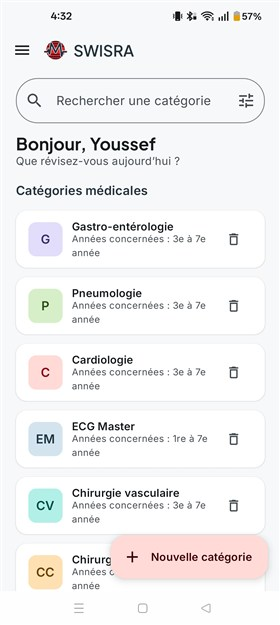 | 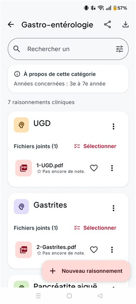 | 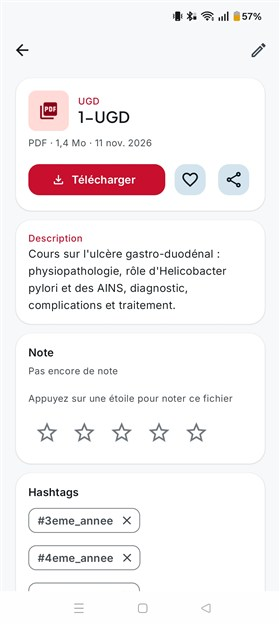 |
| Category list, search, and admin actions | Reasonings and their files, ready to select and share | Download, favorite, share, rate |

| File preview | Search | Statistics (admin) |
|:---:|:---:|:---:|
| 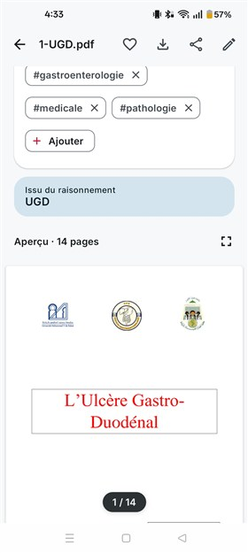 | 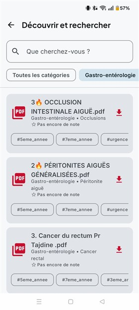 | 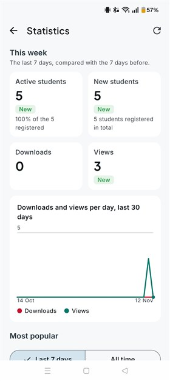 |
| Read the PDF in the app, without downloading it | Filter by category, hashtags on every result | Weekly activity and a 30-day chart |

## Features

### For students

- **Accounts:** sign up with a 6-digit code sent by email, sign in with email and password, reset a forgotten password. The app renews the session in the background, so students stay signed in until they haven't opened it for 60 days. Being offline never signs anyone out.
- **Browse:** categories → reasonings → files. Long reasoning texts fold behind "Read more". The home and category screens filter their lists as you type, accents ignored.
- **Search:** by file name, category, reasoning or `#hashtag`, with an advanced search screen.
- **File page:** a preview of PDFs, Word, PowerPoint and Excel files and images (full screen with zoom), the file's hashtags, its rating, and Download, Favorite and Share buttons on one line.
- **Download:** single files, or a whole reasoning or category as a ZIP, through Android's download manager. A **Recent downloads** screen lists them, newest first.
- **Share:** send a file, several files, a whole reasoning or a whole category (one ZIP with a folder per reasoning) to email, Google Drive, OneDrive, Quick Share or any other app on the phone, to open them on a laptop or tablet. Shared files also appear in Recent downloads.
- **Favorites and ratings:** favorite files and rate them from 1 to 5 stars. A change shows on every screen at once.
- **What's new:** the latest uploads, with a NEW badge on files added since the last visit and a counter in the side menu.
- **Projects (workshops):** first-come, first-served or motivation-letter projects, with their description, capacity, dates, documents and an Upcoming / Open / Closed status that changes on its own at the right time. "Register now" opens the organisers' form while registration is open.
- **Push notifications:** new study files, a new project, 10 minutes before registration opens, when it opens, 10 minutes before it closes and when it closes. Tapping one opens the right screen, even after signing in first. New-file alerts have their own notification category, so they can be turned off while keeping workshop alerts.
- **Suggestions:** send the team a suggestion with an optional file (up to 10 MB).
- **Profile:** edit names and phone, change password or email (confirmed by a code), pick the language (French or English) and the theme (Light, Dark, Like the phone), and delete the account.

### For admins

- Create, edit and delete categories, reasonings and files from the screens students use, always with a confirmation before deleting.
- Upload several files at once, with one description and hashtags for all of them. Students get a single notification for the whole upload.
- Edit a file's title, description and hashtags, with hashtag autocomplete, and add or remove hashtags on several files at once.
- Create and edit projects, attach documents, force a status (for example, close a full project), and delete projects.
- A suggestions inbox with unread markers, the sender's contact details and a preview of the attachment.
- A statistics screen: active and new students, downloads and views compared with the previous week, a 30-day chart, the most popular files and categories, and what needs attention.

## Technical guide

**Contents**

1. [Architecture](#1-architecture)
2. [Data model](#2-data-model)
3. [The modules in action](#3-the-modules-in-action)
4. [Build variants](#4-build-variants)
5. [Tools used](#5-tools-used)
6. [Running it locally](#6-running-it-locally)
7. [Tests](#7-tests)
8. [CI/CD and releases](#8-cicd-and-releases)

### 1. Architecture

#### 1.1 Overview

The app follows **MVVM** in a single `:app` module, without a dependency-injection framework. Screens send events to ViewModels, ViewModels expose their state as `StateFlow`, and everything that talks to the outside world lives in the data layer.

<sub>Source: [`architecture.mmd`](docs/diagrams/architecture.mmd)</sub>

#### 1.2 Code layout

Under `app/src/main/java/com/example/medrational_android`:

| Package | Role |
|---|---|
| `data/api` | Retrofit interface, the `ApiClient` singleton (OkHttp, JWT interceptor, session renewal). |
| `data/auth` | `TokenManager` (session in `EncryptedSharedPreferences`) and `SessionRenewer`. |
| `data/model` | DTOs that mirror the backend's, field for field, plus date and file-type helpers. |
| `data/download` | `AndroidDownloader`, a wrapper around Android's `DownloadManager`. |
| `data/preview` | Rendering PDF pages for previews, and their cache. |
| `data/upload` | Reading picked files and splitting uploads into batches. |
| `data/rating` | `FileRatingStore`, the latest rating of each file, shared by every screen. |
| `data/push` | Firebase messaging service, topics and the routing of notification taps. |
| `data/locale`, `data/settings` | Language (French / English) and theme choices. |
| `data/crash` | Turning Crashlytics on for release builds only. |
| `viewmodel` | One ViewModel per feature, each exposing a `StateFlow` UI state. |
| `ui/<feature>` | Compose screens by feature: `auth`, `categories`, `reasonings`, `files`, `search`, `favorites`, `downloads`, `novelties`, `workshops`, `suggestions`, `profile`, `statistics`, `welcome`. |
| `ui/components`, `ui/theme`, `ui/text` | Shared components, the SWISRA theme (colors, fonts, shapes, spacing) and translatable text. |
| `MainActivity.kt` | Entry point: initializes `ApiClient`, push and crash reporting, and holds the single `NavHost`. |

#### 1.3 State and error handling

- Every screen's state is a sealed type: `Loading`, `Success(data)` or `Error(message)`. Screens collect it with `collectAsStateWithLifecycle()`.
- Network calls run in `viewModelScope` and catch `IOException` and `HttpException`. The app shows its own message, chosen from the HTTP status, never the backend's text.
- ViewModels never hold a `String` for the user: they expose `UiText` (a string resource and its arguments), resolved in the current language when shown.

#### 1.4 Navigation

One `NavHost` in `MainActivity` holds every route. The app opens on `categories` when a session is stored and on `welcome` otherwise. Secondary sections are reached from the home screen's ☰ side menu; other screens have a back arrow. Taps made while a screen is still changing are ignored, so a quick double tap never opens a page twice or leaves a blank screen.

<sub>Source: [`navigation.mmd`](docs/diagrams/navigation.mmd)</sub>

### 2. Data model

#### 2.1 Where the data lives

All data lives on the server. The database schema (ERD) is in the [backend README](https://github.com/Yorkchk/MedRational#2-data-model-erd). The app keeps no local database; it only mirrors the backend's DTOs in `data/model/Models.kt`, read with Gson. Paged endpoints return a `PageResponse<T>`, whose items are in `content`.

#### 2.2 Main models in the app

<sub>Source: [`data-model.mmd`](docs/diagrams/data-model.mmd)</sub>

#### 2.3 What the app keeps on the phone

| What | Where | Why |
|---|---|---|
| JWT, refresh token, role, user ID, email, name | `EncryptedSharedPreferences` (`TokenManager`) | Stay signed in. Excluded from Android backups. |
| Language and theme | AppCompat settings | Applied at startup. |
| Ratings shown on screen | Memory (`FileRatingStore`) | A rating changed on one screen shows on every other. Cleared on sign-out. |
| Converted PDF previews | App cache (`previews/`) | Don't download the same preview twice. |
| Files being shared | App cache (`shared/`), exposed through a `FileProvider` | Hand them to other apps without exposing anything else. |

### 3. The modules in action

#### 3.1 Authentication and sessions

**Sign-in.** Sign-in is email and password only. `/auth/login` returns a JWT (valid 1 hour) and a refresh token, both saved by `TokenManager`. Emailed 6-digit codes are only used to sign up, reset a password, change a password or email, and delete the account.

**Staying signed in.** When the JWT expires, the server answers 401. OkHttp's `TokenRefreshAuthenticator` then trades the refresh token for a new pair and retries the request once. Requests that fail together renew only once.

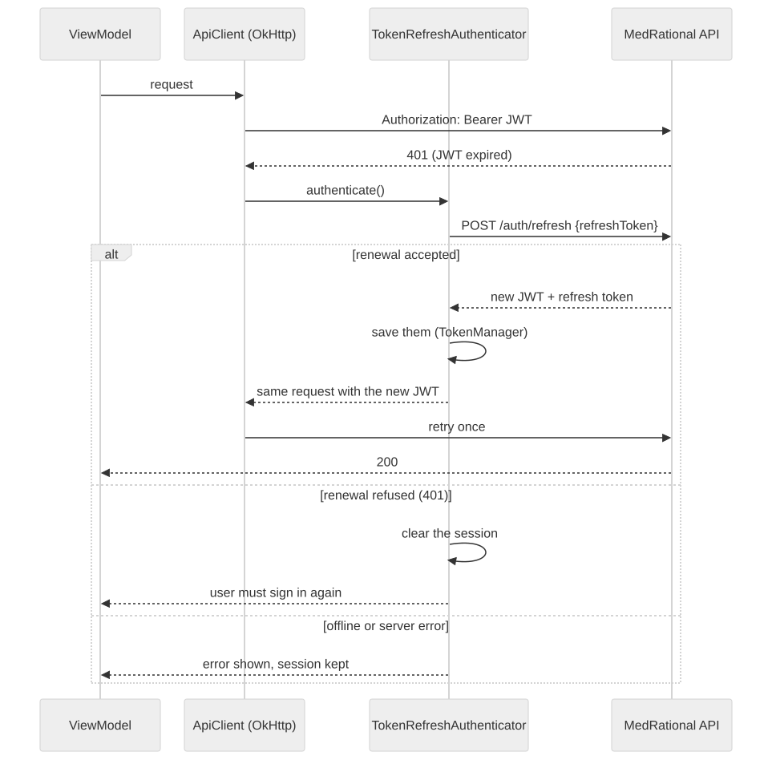
<sub>Source: [`session-renewal.mmd`](docs/diagrams/session-renewal.mmd)</sub>

**When the session ends.**

- A **refused renewal** (401 from `/auth/refresh`) clears the session. Being offline or a server error never does.
- A **403** (signed in but not allowed) clears the session too. That's why admin-only screens are only shown to admins.
- **Signing out** tells the server first (`/auth/logout`), then clears the phone.

**Roles.** `TokenManager.isAdmin()` decides which buttons, dialogs and menu entries are shown. The server checks every admin request again.

#### 3.2 Browsing, search and the file page

- Categories, reasonings and files come from the public `GET` endpoints, so browsing works the same for every user.
- Search sends the filters (file name, category, reasoning, hashtag) to `/search/files` and pages through the results.
- Opening a file records a view for the statistics (signed-in students only).
- **Previews:** PDF pages are drawn with Android's PDF renderer. Office files are converted to PDF by the server and cached on the phone. Images load through Coil, including GIFs, HEIC and AVIF.
- **Favorites and ratings are optimistic:** the screen changes at once, the request follows, and the change is rolled back if it fails.

#### 3.3 Downloads and sharing

Downloads don't go through Retrofit. `AndroidDownloader` hands the URL and the user's token to Android's `DownloadManager`, which shows its own notification and saves the file in **Downloads**. The download manager can't renew a token, so the app renews it first when it expires within 5 minutes. The server records the download, which is how Recent downloads stays up to date.

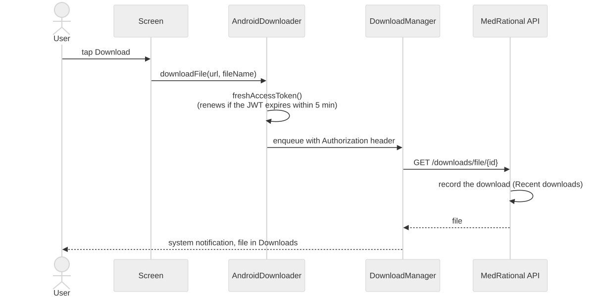
<sub>Source: [`download.mmd`](docs/diagrams/download.mmd)</sub>

**Sharing** downloads the files into the app's private `shared/` cache, then opens Android's share sheet. Several files are sent as separate files. A reasoning or category is sent as one ZIP.

#### 3.4 Admin uploads

- Admins pick one or several files at once.
- One file goes to `/files/upload/{reasoningId}`. Several go to `/files/upload-batch/{reasoningId}`, split into requests of at most 45 MB, because the server accepts 20 MB per file and 50 MB per request.
- Files over 20 MB are skipped, and the result message says so.
- Each request sends students one notification, so batching keeps a whole selection to a single alert. The chosen hashtags are then attached to every uploaded file.

#### 3.5 Projects (workshops)

- The server moves a project from Upcoming to Open to Closed at its registration dates. The list and the project page refetch a few seconds after the next change, so an open screen updates without a refresh.
- The form link is only sent to students while registration is open. The app only opens it, since sign-ups happen on the external form.
- Attachments are private: the app downloads them through the API with the user's token, and previews them (PDF, images, Office files converted to PDF).
- Dates have no time zone. They are read in the phone's zone and always shown in 24-hour format, e.g. "20 Oct 2026, 19:30".

#### 3.6 Push notifications

The app subscribes to its environment's topic at every start, signed in or not, and never unsubscribes. That way, signing out never makes a student miss a registration opening. On Android 13 and later it asks for the notification permission at startup.

<sub>Source: [`push-tap.mmd`](docs/diagrams/push-tap.mmd)</sub>

- Two notification channels: `workshop_reminders` and `new_files`.
- Workshop notifications carry a string key, so they show in the app's language.

#### 3.7 Suggestions

Students send a title, a description and an optional file (multipart). They see a thank-you message, with no thread. Admins get an inbox with unread markers. Opening a suggestion shows the sender's name, email and phone and a preview of the attachment, and an admin can download or delete it.

#### 3.8 Profile and account deletion

- Names and phone save directly.
- **Password change:** a code is sent to the current email. Other devices are signed out, and this one gets new tokens.
- **Email change:** a code is sent to the **new** address. The app saves the new token the server returns, because the token is tied to the email.
- **Account deletion:** a code is sent to the email, then a final confirmation deletes the account and signs out.
- Wrong or expired codes answer 400, so they never sign the user out.

#### 3.9 Statistics (admin)

One request (`/admin/analytics/dashboard`) returns every figure, computed by the server. The app only formats them. Its charts are drawn with Compose `Canvas`, without a chart library.

#### 3.10 Languages

- French is the default, whatever the phone's language. English is in `res/values-en/`.
- Strings are split by feature (`strings_<feature>.xml`). A unit test and lint check that every key exists in both languages with the same placeholders.
- The language is switched from the Profile screen, or from Android 13's per-app language settings.
- What admins write (titles, descriptions, hashtags) is shown as written.

#### 3.11 Design system

The SWISRA look lives in `ui/theme` and `ui/components`: brand colors with light and dark palettes, the Plus Jakarta Sans and Inter fonts, shapes and spacing. Shared components cover every state the screens need: loading, error, empty, banners, buttons, top bar and cards. Screens use only these, never raw colors or sizes. On tablets, pages stay centered at a comfortable width and lists switch to two columns.

#### 3.12 Crash reporting

- Crashes and freezes of **uat and prod release builds** go to Firebase Crashlytics, with no user data.
- Debug builds and the dev flavor never report.
- Release builds upload their R8 mapping file, so stack traces are readable.

### 4. Build variants

The environment is a **flavor**, separate from the build type (debug / release). It sets the backend URL, the push topic, the app's name and its ID, so the three apps install side by side:

| Flavor | Backend URL (`local.properties`) | Push topic | App name | Application ID |
|---|---|---|---|---|
| `dev` | `api.devUrl`, default `http://10.0.2.2:8080/` | `workshops-dev` | SWISRA Dev | `ma.scome.swisra.dev` |
| `uat` | `api.uatUrl` (required, `https://`) | `workshops-uat` | SWISRA UAT | `ma.scome.swisra.uat` |
| `prod` | `api.prodUrl` (required, `https://`) | `workshops` | SWISRA | `ma.scome.swisra` |

- Only `dev` allows plain `http://`, for a backend on your own machine. `uat` and `prod` refuse to build with an `http://` URL.
- `uatRelease` is a prod-like build against the test server.
- Release builds are minified and resource-shrunk with R8.

### 5. Tools used

| Area | Tools |
|---|---|
| Language | Kotlin 2.0 |
| UI | Jetpack Compose (Material 3, Navigation Compose, Material icons), AppCompat (per-app language and night mode), SplashScreen |
| Architecture | MVVM, AndroidX ViewModel + Kotlin coroutines and `StateFlow` |
| Networking | Retrofit 2.11, OkHttp 4.12 (interceptor, authenticator, logging in debug), Gson |
| Images and previews | Coil 2.7 (with GIF support), Android `PdfRenderer` |
| Security | AndroidX Security (`EncryptedSharedPreferences`), HTTPS-only network config for uat and prod |
| Firebase | Cloud Messaging (push), Crashlytics |
| Build | Gradle (Kotlin DSL, version catalog), Android Gradle Plugin 8.11, R8 |
| Tests | JUnit 4, MockK, kotlinx-coroutines-test, Compose UI tests, Kover coverage |
| CI/CD | GitHub Actions: lint, tests and builds on every PR, a UAT APK for testers on every merge, signed releases on tags; Dependabot |
| Targets | minSdk 24 (Android 7.0), targetSdk / compileSdk 36 (Android 16) |

### 6. Running it locally

This guide starts from a computer with nothing installed and ends with the app running on an emulator or a phone, connected to a backend on your own machine. Command-line steps are given for **Git Bash, macOS or Linux** (`./gradlew`). In Windows PowerShell or cmd, use `.\gradlew.bat` instead. Run them **from the repository root**.

#### 6.1 What you need, and why

| Piece | Why |
|---|---|
| Android Studio (recent stable) | Editing, building and running the app. It includes the Android SDK, an emulator and a JDK. |
| JDK 17 or newer | Gradle and the Android Gradle Plugin need it. Android Studio's bundled JDK is enough. |
| Android SDK Platform 36 | The app compiles against Android 16. Android Studio installs it on the first sync. |
| An emulator or an Android phone | Android 7.0 (API 24) or newer. Push notifications need Google Play services: use a **Google Play** emulator image, or a real phone. |
| The MedRational backend, running | The app has no offline data. Set it up with the [backend's local guide](https://github.com/Yorkchk/MedRational#7-running-it-locally). |

#### 6.2 Start the backend

Follow the [backend's "Running it locally"](https://github.com/Yorkchk/MedRational#7-running-it-locally) up to the health check: `curl http://localhost:8080/actuator/health` must answer `{"status":"UP"}`. The backend's email setup matters here too: signing up in the app sends a code by email.

#### 6.3 Install Android Studio

1. Download it from <https://developer.android.com/studio> and install it.
2. On first launch, choose the **Standard** setup. It downloads the Android SDK, the build tools and an emulator, which needs several GB of disk space.

#### 6.4 Get the code and open it

```bash
git clone https://github.com/Yorkchk/MedRational-Android.git
```

1. In Android Studio: **File → Open**, and pick the `MedRational-Android` folder.
2. Android Studio runs a **Gradle sync**. The first one downloads Gradle and every library, which takes a few minutes. Accept if it offers to install a missing SDK platform.
3. If the sync complains about the Java version, open **Settings → Build, Execution, Deployment → Build Tools → Gradle** and set **Gradle JDK** to the bundled JDK (`jbr-17` or newer).

Android Studio creates `local.properties` with `sdk.dir`, the path to the Android SDK. This file is git-ignored; you'll add the backend URL to it if needed.

#### 6.5 Point the app at your backend

The `dev` flavor calls `http://10.0.2.2:8080/` by default. That address is your computer as seen **from the Android emulator**, so with an emulator you have nothing to set.

For a **physical phone**, add your computer's local IP to `local.properties`:

1. Connect the phone and the computer to the **same Wi-Fi**.
2. Find the computer's local IP: `ipconfig` on Windows (the IPv4 address of the Wi-Fi adapter), `ipconfig getifaddr en0` on macOS, `hostname -I` on Linux.
3. Add this line to `local.properties`, with your IP:
   ```properties
   api.devUrl=http://192.168.1.20:8080/
   ```
   Keep the trailing `/`.
4. The URL is fixed when the app is built, so **build again** after changing it.
5. On Windows, if a firewall prompt appeared when the backend started, allow Java on **private networks**. Otherwise the phone can't reach port 8080.

You only need `api.uatUrl` and `api.prodUrl` to build the `uat` and `prod` flavors (see [6.10](#610-release-builds-uat-and-prod)).

#### 6.6 Create an emulator

Skip this step if you use a phone.

1. Open **Device Manager** (the phone icon on the right, or **View → Tool Windows → Device Manager**) and click **+ → Create Virtual Device**.
2. Pick a phone (e.g. **Pixel 8**), then a system image with **Google Play** in its name (API 34 or newer is fine). Download it if needed.
3. Finish, then start the emulator with ▶.

#### 6.7 Or prepare a physical phone

1. On the phone: **Settings → About phone**, tap **Build number** 7 times to unlock developer options.
2. **Settings → System → Developer options**: turn on **USB debugging**. The exact menu names vary by brand.
3. Plug the phone in with a USB data cable, and accept **Allow USB debugging** on the phone.
4. It now shows in Android Studio's device list.

#### 6.8 Run the app

1. Open **Build Variants** (**View → Tool Windows → Build Variants**) and set the `app` module to **`devDebug`**.
2. Pick your emulator or phone in the toolbar and click **Run ▶**.

From the command line instead, with an emulator running or a phone plugged in:

```bash
./gradlew installDevDebug
```

The app installs as **SWISRA Dev** (`ma.scome.swisra.dev`), next to the Play Store app if it is there. On Android 13 and later it asks for permission to send notifications: allow it to get workshop and new-file alerts.

#### 6.9 Your first session

1. **Sign up** in the app. The 6-digit code arrives by email, sent by your backend, and is valid for 5 minutes.
2. **Make yourself an admin.** There is no button for this, on purpose. Run the SQL from the [backend guide, step 7.9](https://github.com/Yorkchk/MedRational#79-create-your-first-admin-and-try-it) on your local database:
   ```sql
   update users set role = 'ROLE_ADMIN' where email = 'you@example.com';
   ```
3. **Sign out and in again.** The app reads the role at sign-in, so the admin buttons appear only after this.
4. Create a category from the home screen's **+**, open it to add a reasoning, then upload a file into it. File uploads need the backend's R2 storage set up.
5. **Push notifications (optional):**
   - The app's Firebase config, `app/google-services.json`, is in the repository, so the dev app subscribes to the `workshops-dev` topic on its own.
   - For notifications to arrive, your backend needs `FIREBASE_CREDENTIALS`: a service-account key from **the same Firebase project**.
   - The emulator must use a Google Play image.

#### 6.10 Release builds (uat and prod)

You don't need these to work on the app. They exist to test what users get.

1. Add the HTTPS URLs to `local.properties`. Building without them fails with `Set api.uatUrl … in local.properties`.
   ```properties
   api.uatUrl=https://uat.example.com/
   api.prodUrl=https://api.example.com/
   ```
2. Android only installs **signed** APKs, and release builds are only signed when a key is configured. To sign with your own key, create one:
   ```bash
   keytool -genkeypair -v -keystore my-upload.jks -keyalg RSA -keysize 2048 -validity 10000 -alias upload
   ```
   Then add it to `local.properties`. `*.jks` files are git-ignored.
   ```properties
   signing.storeFile=my-upload.jks
   signing.storePassword=…
   signing.keyAlias=upload
   signing.keyPassword=…
   ```
3. Build:
   ```bash
   ./gradlew assembleUatRelease     # APK in app/build/outputs/apk/uat/release/
   ./gradlew bundleProdRelease      # Play Store bundle in app/build/outputs/bundle/prodRelease/
   ```

#### 6.11 Troubleshooting

| Symptom | Cause and fix |
|---|---|
| Sync fails: `Android Gradle plugin requires Java 17` | Set **Gradle JDK** to 17 or newer (step 6.4). For the command line, point `JAVA_HOME` to a JDK 17+. |
| `SDK location not found` | `local.properties` has no `sdk.dir`. Open the project once in Android Studio, or add `sdk.dir=` with your SDK path. |
| `Set api.uatUrl … in local.properties` | You're building `uat` or `prod`. Switch the variant to `devDebug`, or add the URL (step 6.10). |
| `… must start with https://` | `uat` and `prod` only accept HTTPS backends. |
| Every screen shows a connection error | The backend isn't running, or the phone can't reach it. `10.0.2.2` only works from the emulator. On a phone, check the IP, the Wi-Fi and the firewall (step 6.5). |
| `CLEARTEXT communication … not permitted` | An `http://` URL in a `uat` or `prod` build. Use `dev` for a local backend. |
| No email code after signing up | The backend's email isn't set up. See the backend's troubleshooting. |
| The app signs out by itself | A 403 or a refused renewal clears the session. A common cause locally: the database was reset, so the stored session no longer exists. Sign in again. |
| No admin buttons after promoting the account | Sign out and in again (step 6.9). |
| No push notifications | Notification permission allowed? Google Play emulator image? Backend `FIREBASE_CREDENTIALS` from the same Firebase project? |
| `INSTALL_FAILED_UPDATE_INCOMPATIBLE` | An app with the same ID but another signature is installed. Uninstall it first. |

### 7. Tests

```bash
./gradlew testDevDebugUnitTest          # JVM unit tests (app/src/test)
./gradlew koverHtmlReportDevDebug       # coverage report (app/build/reports/kover)
./gradlew lint                          # Android lint
./gradlew connectedAndroidTest          # Compose UI tests (app/src/androidTest), needs an emulator or phone
```

- **Unit tests** cover ViewModels and their `StateFlow` states (with MockK and coroutine test dispatchers), the session renewal, upload batching, push routing, statistics maths, and the network security config.
- Every string key must exist in French and English (`StringResourcesParityTest`).
- **UI tests** check layouts such as the file page's buttons on small screens and file selection.
- Every feature ships with tests, and every bug fix with a regression test. Patterns and examples are in [CI and tests](docs/CI_AND_TESTS.md).

### 8. CI/CD and releases

<sub>Source: [`delivery-pipeline.mmd`](docs/diagrams/delivery-pipeline.mmd)</sub>

- **Every pull request** runs `.github/workflows/android-ci.yml`: lint, unit tests, coverage, and the `devDebug` and `devRelease` builds. Only the dev flavor runs, since CI has no uat or prod URLs.
- **Every merge to `main`** runs `publish-uat-apk.yml`, which publishes a signed UAT APK as the GitHub pre-release `uat-<n>`, for testers.
- **Pushing a `v*` tag** runs `release.yml`, which builds the signed prod AAB and APK and creates the GitHub Release from that version's `CHANGELOG.md` section.
- The version code is the number of commits on `main`, and the version name comes from the tag.

## Contributing

`main` is protected and always releasable. Work happens on short-lived branches (`feat/…`, `fix/…`, `chore/…`, `docs/…`) merged through pull requests once CI passes. Commit messages and PR titles follow [Conventional Commits](https://www.conventionalcommits.org/), and every change ships with tests. User-facing changes are recorded in [CHANGELOG.md](CHANGELOG.md).

## Documentation

- [CI and tests](docs/CI_AND_TESTS.md): what runs on every pull request, how to read failures, and how to add tests.
- [GitHub repository setup](docs/GITHUB_REPO_SETUP.md): the branching, PR, CI and release workflow.
- [Brand](docs/brand/README.md): the SWISRA logo, colors and fonts.
- [Diagrams](docs/diagrams/README.md): how to edit and regenerate the README's diagrams.

## License

[MIT](LICENSE)
